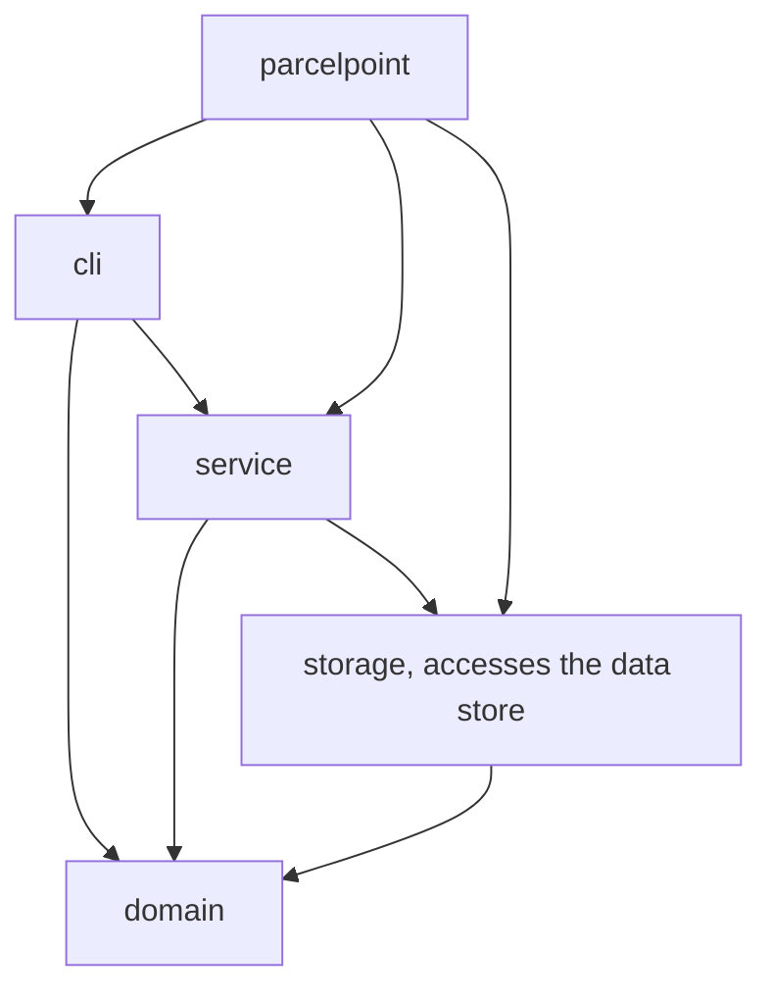
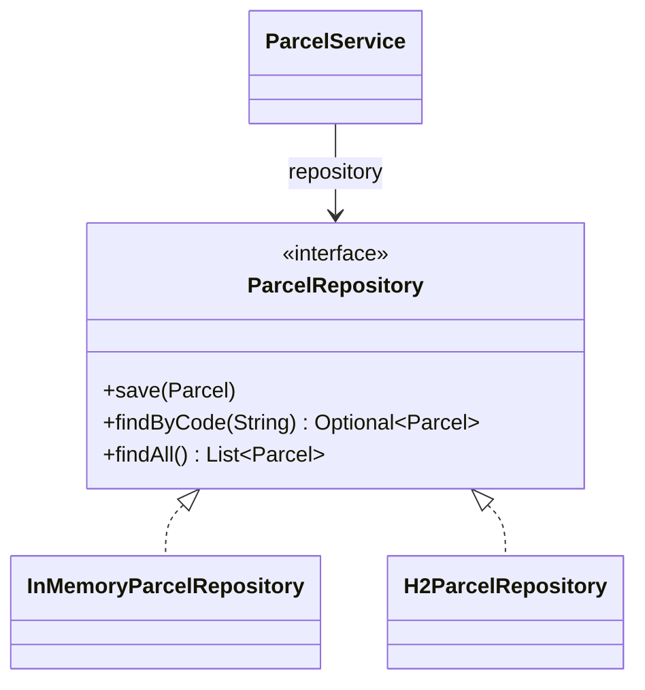
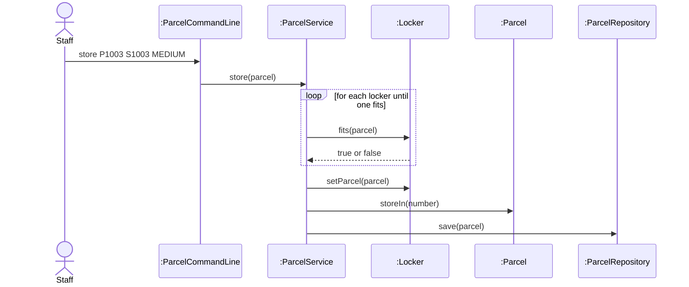

# Lab Report, Designing the Data Management Layer with H2

Repository URL:

## Tools

| Item | Version or name |
| --- | --- |
| JDK | 23.0.1 |
| Maven | 3.10.0, using Java 23.0.1 |
| IDE | Cursor 1.144.0 |
| AI tool and exact model, if you used one | Cursor, Grok 4.7, on 4 November 2026 |

## Part 0. From a store in memory to H2

Commit of the starter, before any change: 92207b3

0.3 Your prediction for `staff`, written before the second run:

I expected `staff` to list P1001 and P1002 again, because the first run had stored both of them, and to report one free locker.

Output of the second run, for `staff` and `quit`:

```text
> staff
Free lockers: 3
> quit
```

State in one sentence where you think the parcels of the first run were kept.

They were kept only in the map inside InMemoryParcelRepository, which lives in the memory of that run and is freed when the program ends.

0.5 The line of Main that you would change to keep the parcels somewhere else:

```java
ParcelRepository repository = new InMemoryParcelRepository();
```

0.6 Commit of the switch to H2: 01bde9b

0.7 Output of `SELECT * FROM PARCEL;` after you stored two parcels:

```text
sql> SELECT * FROM PARCEL;
CODE  | STUDENT_ID | PARCEL_SIZE | STATUS | LOCKER_NUMBER
P1001 | S1001      | SMALL       | STORED | 1
P1002 | S1002      | LARGE       | STORED | 3
(2 rows, 13 ms)
```

0.8 Explain why ParcelPoint could not start while the H2 Shell was open, and identify the class that wrote the message `Cannot create the PARCEL table`.

H2 is an embedded database, so the file `parcelpoint.mv.db` belongs to the one program that has it open. The Shell still held that file, H2 locked it, and ParcelPoint could not open the same database. The first line of the error is not written by H2. The constructor of `H2ParcelRepository` catches the `SQLException` and throws `IllegalStateException` with the message `Cannot create the PARCEL table`. The line under it that starts with `Caused by` is the H2 message `Database may be already in use`.

0.9 Explain why `staff` shows no parcel while `find` shows each one, and why all three lockers look free.

`find` calls `findByCode`, which reads one row from the PARCEL table, so both parcels are in H2. `staff` calls `findAll`, and in the starter that method still returns an empty list. The constructor of `ParcelService` also uses `findAll` to put every waiting parcel back into its locker. With an empty list, no locker is filled, so `countFreeLockers` reports 3 even though the rows are in the table.

0.11 Your findAll method:

```java
@Override
public List<Parcel> findAll() {
    String sql = "SELECT * FROM PARCEL ORDER BY CODE";
    List<Parcel> parcels = new ArrayList<>();
    try (Connection connection = connect();
         PreparedStatement statement = connection.prepareStatement(sql);
         ResultSet row = statement.executeQuery()) {
        while (row.next()) {
            parcels.add(toParcel(row));
        }
    } catch (SQLException e) {
        throw new IllegalStateException("Cannot read the parcels", e);
    }
    return parcels;
}
```

Commit that adds findAll: 602fabd

0.12 Output of `SELECT * FROM PARCEL;` after the pickup:

```text
sql> SELECT * FROM PARCEL;
CODE  | STUDENT_ID | PARCEL_SIZE | STATUS    | LOCKER_NUMBER
P1001 | S1001      | SMALL       | PICKED_UP | null
P1002 | S1002      | LARGE       | STORED    | 3
(2 rows, 15 ms)
```

0.13 Optional. Describe what `find P9999'OR'1'='1` showed while the SQL was joined from strings, and what it showed after you put the placeholder back.

While the code was joined into the SQL text, `find P9999` correctly said there was no such parcel, but `find P9999'OR'1'='1` printed `P1001, S1001, SMALL, PICKED_UP`. The quotes in the input closed the string and added `OR '1'='1'`, which is true for every row, so the query returned every parcel and `findByCode` showed the first one. After the `?` placeholder and `setString` were put back, the same command printed `No parcel with code P9999'OR'1'='1`, because H2 compared CODE with the whole text and no row matched. The broken method was discarded and was not left in the repository.

## Part A. Model the design

A1 Complete the flowchart with one node for each package and one arrow for each dependency, from the package that uses to the package that is used. Mark the package that accesses the data store.



State whether cli depends on storage, and explain why.

`cli` does not depend on `storage`. `ParcelCommandLine` imports classes from `domain` and `service` only. It asks `ParcelService` to store, find and list parcels, and it never names `ParcelRepository` or `H2ParcelRepository`.

A2 Complete the class diagram of the data management layer with ParcelService, the interface ParcelRepository with its three operations, and the two classes that implement it.



A3 Draw a sequence diagram for the command `store P1003 S1003 MEDIUM`, from the staff member to the repository. Show each message as an operation of the class that receives it.



Explain why the last lifeline is the interface ParcelRepository rather than H2ParcelRepository.

`ParcelService` depends on the interface `ParcelRepository`, not on a concrete store. This is the Dependency Inversion Principle. The service sends `save` to whatever object `Main` passed in, so the same sequence is true for `InMemoryParcelRepository` and for `H2ParcelRepository`. Naming `H2ParcelRepository` on the diagram would show a class that `ParcelService` never mentions.

## Part B. Design questions

1. Identify the files that you changed to move from the store in memory to H2, and explain why no other class had to change. Use the terms of this course.

The only file changed for the switch was `Main.java`. Its import and the line in `main` changed from `new InMemoryParcelRepository()` to `new H2ParcelRepository("./data/parcelpoint")`. No other class had to change because `ParcelService` depends on the interface `ParcelRepository`, and both repository classes realize that interface. `Main` is the one class that names a concrete repository, so the data store changes in that one place. `ParcelCommandLine` and the classes in `domain` stay above the boundary and never see SQL or a connection. `findAll` was filled in later, in `H2ParcelRepository`, so that `staff` could read the rows the table already held. That completed the H2 repository. It did not change the boundary.

2. The PARCEL table stores the size of a parcel as SMALL, MEDIUM or LARGE rather than as 1, 2 or 3. Identify the type of connascence between ParcelSize and the table in each case, and explain which one is weaker.

Storing `SMALL`, `MEDIUM` and `LARGE` is connascence of name. The column and `ParcelSize.valueOf` must agree on the names of the enum constants, and `toParcel` turns that name straight back into a `ParcelSize`. Storing `1`, `2` or `3` would be connascence of convention. Both sides would have to agree on what each number means, and the row itself would not say so. Connascence of name is the weaker of the two. A change is easier to see, because the value in the table is the same word the program already uses.

3. Project Phase 2 asks for a data store that needs no separate server. Explain why an embedded database such as H2 meets this rule, and describe the limit of an embedded database that Step 0.8 showed.

H2 meets the rule because it is a library inside the program. It keeps the database in `parcelpoint.mv.db`, and `CREATE TABLE IF NOT EXISTS` creates the table on the first run, so no database server has to be installed or started. The limit from Step 0.8 is that the file belongs to one process at a time. While the H2 Shell had the database open, ParcelPoint could not open it, and H2 reported that the database may already be in use.

4. State the data store that you would choose for your Project Phase 2 team, files or an embedded database, the requirement that drives the choice, and the package that will access it.

I would choose an embedded database. The requirement that drives the choice is that the data must remain after the program ends, must be created on the first run, and must be readable by a key, without a separate server and with at most one library for the store. The package that will access it is `storage`. A repository interface stays the boundary, and `Main` creates the concrete repository, so the service layer does not depend on the database.

## AI usage declaration

| AI tool and exact model | Date | Purpose | Files or answers it produced or changed | How you checked its output |
| --- | --- | --- | --- | --- |
| Cursor, Grok 4.7 | 4 November 2026 | Switched Main to H2, wrote findAll, ran the store, staff, pickup and SQL steps, and drafted this report from the lab sheet and that run. | `Main.java`, `H2ParcelRepository.java`, `LAB_REPORT.md` | `mvn package` succeeded. After findAll, staff listed P1001 and P1002 and one free locker. Pickup of P1001 for 5 days printed a fee of 20.0 baht, and `SELECT * FROM PARCEL` showed PICKED_UP with a null locker. The string-joined find showed P1001, and the restored placeholder did not. The broken findByCode was checked out of the working tree and is not in the findAll commit. |
